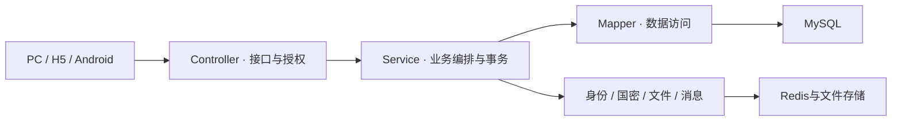

# 平台架构

## 总体结构

平台采用前后端分离的单体多模块架构。PC、客户H5、工程师H5和Android入口共用一个Spring Boot后端，功能域通过统一平台能力协作。

## 后端模块

父Maven工程组织16个子模块，由 `ls-aegis-boot` 装配启动。

| 层次 | 模块 | 职责 |
|---|---|---|
| 装配入口 | boot、starter | 应用启动、公共组件装配与框架适配 |
| 基础能力 | common、mybatis、redis、security、crypto | 公共模型、持久化、缓存、安全与SM2/SM3/SM4 |
| 平台服务 | rbac、biz-file、biz-notice | 账户组织权限、文件和消息 |
| 扩展能力 | biz-tenant、biz-schedule | 租户与调度，按配置启用 |
| 业务域 | biz-psi、biz-quote、biz-eoms、biz-sign | 进销存、报价、运维和签章 |

Controller接收请求并衔接授权；Service承担状态、事务与跨域调用；Mapper承担数据访问。业务域共用平台服务，禁止绕过所属服务直接修改其他域的关键数据。

## 前端组织

PC采用Vue3、Vite和Arco，公共页面链为GiPageLayout、BaseTable、useTable、GiForm。领域接口分别位于 `apis/psi`、`apis/eoms`、`apis/quote`、`apis/sign`，顶层apis维护平台接口。

H5采用Vue、Vite和Vant。customer与engineer模式分别选择角色路由，只将本端页面加入构建。Android通过WebView承载对应H5，不另建业务后端。

## 数据与安全边界

MySQL维护业务持久化记录，Redis承载缓存与会话等运行状态，文件存储保存附件和签署材料。身份、角色权限与数据范围在后端共同生效，前端菜单和按钮只承担交互层控制。

金额、库存、状态机与跨模块协作见[业务流程](../business/overview.md)；响应和幂等要求见[接口契约](contracts.md)。Java包名、Maven artifact、接口标识与已执行迁移ID属于工程契约，不随展示名称替换。
