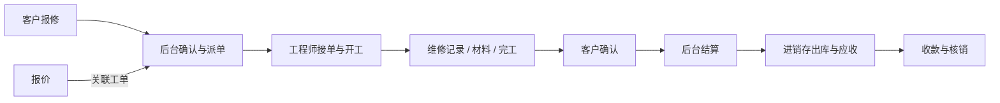

# 模块与业务联动

## 功能域职责

| 功能域 | 负责内容 | 数据边界 |
|---|---|---|
| 平台管理 | 账户、组织、角色、菜单、文件与消息 | 统一身份及资源授权 |
| 进销存 | 客商、商品、仓库、采购销售、库存与往来资金 | 单据驱动库存和应收应付 |
| 报价 | 报价明细、金额、状态和文档导出 | 管理报价内容并关联运维工单 |
| 运维 | 报修、派单、工程师任务、维修记录与结算 | 维修业务编排，库存和财务交由进销存 |
| 签章 | 项目、印章、待签文件、签署与结果验证 | 按项目与文件权限组织签署材料 |

## 经营与资金

采购、销售等业务以单据为载体，按各自状态进入审核和出入库处理。库存数量与成本由进销存服务维护，关联应付或应收后，再通过实际付款或收款完成资金登记与核销。

单据状态、库存变化、往来金额和实际资金是不同维度。金额计算遵循后端定点精度与舍入规则；不能以页面显示或状态名称代替财务入账。

## 报价与运维

客户首次通过管理员签发的一次性邀请码激活账户，自设用户名与密码；后续通过客户门户登录。工程师使用平台账户，任务范围由后台授权和工单归属共同决定。

运维结算通过进销存服务处理材料出库与应收，结算确认不代表已收款。流程重试、并发或接口重复提交不得重复出库、重复生成应收或重复收款。

### 客户公司与成员账号

同一客户公司可关联多个客户服务App账号，每位成员独立使用用户名和密码。普通员工只能查看自己提交的报修、关联维修进度和附件，并确认自己的维修结果；公司管理员可查看和确认本公司全部报修。账号角色由平台维护，客户端不能自行改变所属公司、提交人或可见范围。

平台在“进销存 → 往来单位”的客户行打开“App成员”，选择普通员工或公司管理员后签发一次性新增成员码。成员在客户服务App的“首次使用”入口填写邀请码，自设个人账号和密码。新增成员码不能覆盖已有账号；忘记密码时，平台须对指定成员单独签发重置码，成员沿用原用户名设置新密码，其他成员不受影响。

平台可修改成员姓名、角色及启停状态；修改后该成员的旧会话失效，需要重新登录。公司至少保留一名启用的管理员。原有客户账号升级后保留用户名和密码，作为公司管理员继续使用；历史报修无法可靠归属到个人时，仅对公司管理员开放，不自动分配给某位员工。

### 照片与附件

工程师账号使用平台统一密码策略：首次登录或密码过期时先进入移动端改密页面，当前密码和新密码通过既有SM2链路提交至个人改密接口。修改成功后退出并重新登录，再进入工作台与待办；“我的”页面也提供主动改密入口。过期限制不通过清空标记或关闭策略绕过，不改变原派单与维修状态机。

工程师签到、签退各自保存本次坐标、系统解析地址和操作备注，与工单原服务地点分别管理。手机系统无法解析中文地址时仅回退坐标；无法取得有效坐标时不能提交签到或签退。完成维修前必须已有维修记录，签退后仍需走客户确认、后台结算和平台财务库存流程。

维修及完成照片中的客户名称从已授权工单关联的客户资料读取，维修人员取当前登录身份；客户单位与上传人员分别展示，不将工程师账号当成客户名称。已生成的水印随原照片保留，后续规则变更只作用于新上传照片。

客户报修照片为1至9张，工程师维修中、维修完成照片分别最多6张，保留可选语义。移动入口接受每张不超过10MB的JPG、PNG，校验文件内容后排队上传，同时最多处理2张。位置授权失败时使用时间水印，不填造坐标；服务端按已登录客户或工单归属生成业务水印。水印采用左下角半透明资料卡，标题按阶段为“报修资料、维修资料、完成资料”，空字段不展示，长地址和项目名自动换行。手机定位提供经纬度，Android App优先使用系统地址解析，中文地址随照片传递；浏览器或系统解析不可用时仅回退坐标，平台外部地图API已停用，包含照片、签到签退和后台测试入口。客户公司名显示为“报修客户”，不自动填充“任务名称”；任务字段独立。客户照片使用“报修地址／报修人”，报修人取当前登录成员姓名，表单联系人另行保存；工程师照片使用“服务地址／维修人员”，人员取登录身份。备注按添加照片时的填写内容记录，空备注不生成水印行；业务单据同时保存备注。

两端Android App先选择拍照或相册，拍摄结果经确认后进入同一上传队列，取消不清空原表单。相册仅访问用户选中的图片；相机委托系统应用处理，不额外申请全相册、麦克风或后台位置权限。服务端在加水印前归正JPEG方向，避免现场竖图在上传后横转。

上传与业务保存分开：等待、上传或失败的照片会阻止提交，失败项可以重试或删除；保存失败时保留已成功照片。报修和维修记录只引用服务端文件ID，预览继续执行平台鉴权。删除草稿照片、关闭预览或离页会取消本页请求并释放预览资源，不物理删除仍被业务引用的附件；未关联文件由文件中心按权限管理，不按目录或时间批量盲删。

PC头像先裁剪后保存，品牌图片转换后更新配置，印章图片沿用签章权限及独立保存流程。通用附件保留各业务的PDF、Office等格式要求，不套用报修图片格式限制。

## 电子签章

签章以项目组织文件和印章，先进行权限及可签条件判断，再完成签署准备、执行和结果输出。回执、验签与下载沿用文件授权和签章业务边界，签署材料及密钥进入独立持久化存储。

## 跨域约束

各端通过所属业务接口协作。后端同时约束用户身份、角色、部门、客户或工程师归属及启用租户；业务事务负责状态与关联记录的一致性。代码生成和应用管理不属于当前产品功能。

## 接单与维修完成

报修提交后立即保存并等待接单；自提交起满十分钟仍无人实际接单时，同租户启用工程师可从工单池领取，后台未确认不会阻止开放。领取在同一事务中衔接工单、确定工程师及接单时间；后台派单只指定负责人，由工程师确认接单。已有已接单、维修中和完成任务不回退。

维修记录可同时登记商品配件、仓库、数量及备注；两者一起保存或一起回滚。工程师只记录服务与实物用料，后台维护收费，结算经PSI正式出库并使用实际FIFO成本。工程师签退后显示维修已完成，工单在后台仍待结算，客户确认、应收与收款保持各自的业务边界。

报修地址属于客户提交信息，签到和签退地址属于现场服务动作；三者分别保存，旧记录没有报修地址时不推测或回填。
