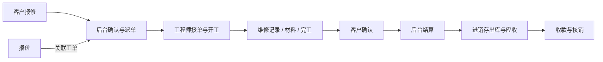

# 模块与业务联动

## 功能域职责

| 功能域 | 负责内容 | 数据边界 |
|---|---|---|
| 平台管理 | 账户、组织、角色、菜单、文件与消息 | 统一身份及资源授权 |
| 进销存 | 客商、商品、仓库、采购销售、库存与往来资金 | 单据驱动库存和应收应付 |
| 报价 | 报价明细、金额、状态和文档导出 | 管理报价内容并关联运维工单 |
| 运维 | 报修、派单、工程师任务、维修记录与结算 | 维修业务编排，库存和财务交由进销存 |
| 签章 | 项目、印章、待签文件、签署与结果验证 | 按项目与文件权限组织签署材料 |

## 经营与资金

采购、销售等业务以单据为载体，按各自状态进入审核和出入库处理。库存数量与成本由进销存服务维护，关联应付或应收后，再通过实际付款或收款完成资金登记与核销。

单据状态、库存变化、往来金额和实际资金是不同维度。金额计算遵循后端定点精度与舍入规则；不能以页面显示或状态名称代替财务入账。

## 报价与运维

客户首次通过管理员签发的一次性邀请码激活账户，自设用户名与密码；后续通过客户门户登录。工程师使用平台账户，任务范围由后台授权和工单归属共同决定。

运维结算通过进销存服务处理材料出库与应收，结算确认不代表已收款。流程重试、并发或接口重复提交不得重复出库、重复生成应收或重复收款。

## 电子签章

签章以项目组织文件和印章，先进行权限及可签条件判断，再完成签署准备、执行和结果输出。回执、验签与下载沿用文件授权和签章业务边界，签署材料及密钥进入独立持久化存储。

## 跨域约束

各端通过所属业务接口协作。后端同时约束用户身份、角色、部门、客户或工程师归属及启用租户；业务事务负责状态与关联记录的一致性。代码生成和应用管理不属于当前产品功能。
