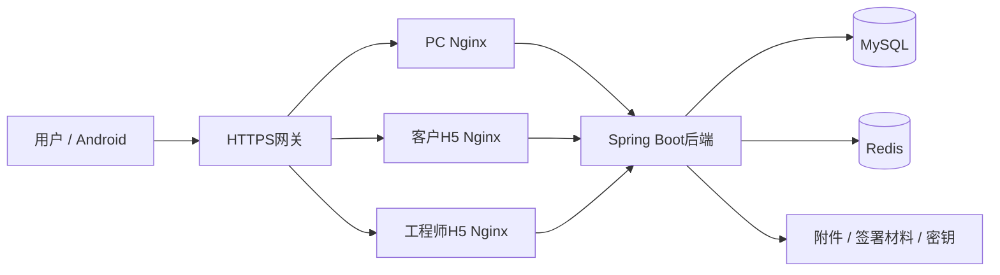

# 部署与环境分层

## 服务拓扑

生产环境由根docker-compose.yml统一编排MySQL、Redis、后端、PC和两端H5。网关承接外部访问，后端通过内部网络连接数据库和缓存；各端Nginx提供静态资源并转发API。

## 环境职责

| 环境 | 编排来源 | 应用与存储关系 |
|---|---|---|
| 源码开发 | docker/docker-compose.yml与开发覆盖 | 容器提供MySQL/Redis，应用由宿主运行 |
| 新服务器 | 根docker-compose.yml与根.env | prod配置，宿主目录持久化，网关提供HTTPS |
| 已有本机完整部署 | 根Compose与docker-compose.local.yml | 复用既有external卷和原附件/密钥目录，保留本机profile语义 |

本机覆盖要求Compose2.24.4+，不能直接用作新服务器模板。部署目录决定相对绑定路径；新克隆源码目录不自动具备原数据库、附件或真实配置。本机覆盖通过LS_AEGIS_DATA_DIR和LS_AEGIS_LOG_DIR指定持久化目录；切换源码目录时可继续绑定原存储，无需搬迁附件或密钥。

## 网络与入口

源码开发及本机完整部署的标准入口为PC5173、客户5174、工程师5175、API8000。根生产Compose的宿主入口为API25682、PC25683、客户25684、工程师25685，默认绑定回环地址，由外层网关提供访问。

生产MySQL与Redis宿主端口分别为25606和25679。数据库与缓存不作为公开业务入口；外部域名、HTTPS证书和前端路径前缀应与部署配置一致。

## 镜像与配置

自有镜像版本由工程版本与部署变量统一选择。后端、PC和两端H5分别构建；客户与工程师H5使用H5_ROLE选择各自页面。根.env.example提供配置字段，真实.env独立管理。服务器安装与更新入口为scripts/install.sh和scripts/deploy.sh。

容器可以替换，持久化存储独立保留。运行关系及恢复顺序见[数据与密钥](data-and-recovery.md)。默认生产栈不启用媒体服务。

## 数据库升级

全新空库使用ls-aegis-server/sql/init.sql。已有库按适用范围执行增量升级，不能重放全量初始化或任意改写已执行changeset。

受限入口分别见[R29](../../docker/ls-aegis-server/MIGRATION-R29.md)、[R31](../../docker/ls-aegis-server/MIGRATION-R31.md)、[R32](../../docker/ls-aegis-server/MIGRATION-R32.md)及[R43/R44](../../docker/ls-aegis-server/MIGRATION-R43-R44.md)。这些入口只覆盖固定发布范围，不是完整master的通用执行器。
