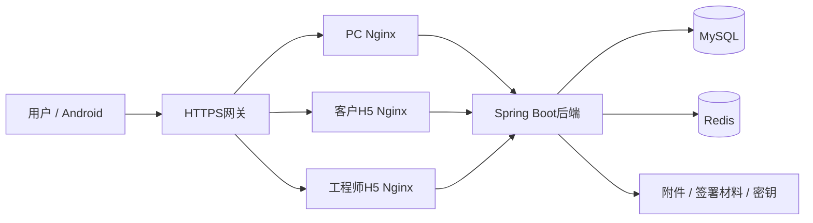

# 部署与环境分层

## 服务拓扑

生产环境由根docker-compose.yml统一编排MySQL、Redis、后端、PC和两端H5。网关承接外部访问，后端通过内部网络连接数据库和缓存；各端Nginx提供静态资源并转发API。



## 环境职责

| 环境 | 编排来源 | 应用与存储关系 |
|---|---|---|
| 源码开发 | docker/docker-compose.yml与开发覆盖 | 容器提供MySQL/Redis，应用由宿主运行 |
| 新服务器 | 根docker-compose.yml与根.env | prod配置，宿主目录持久化，网关提供HTTPS |
| 已有本机完整部署 | 根Compose与docker-compose.local.yml | 复用既有external卷和原附件/密钥目录，保留本机profile语义 |

本机覆盖要求Compose2.24.4+，不能直接用作新服务器模板。部署目录决定相对绑定路径；新克隆源码目录不自动具备原数据库、附件或真实配置。本机覆盖通过LS_AEGIS_DATA_DIR和LS_AEGIS_LOG_DIR指定持久化目录；切换源码目录时可继续绑定原存储，无需搬迁附件或密钥。

## 网络与入口

源码开发及本机完整部署的标准入口为PC5173、客户5174、工程师5175、API8000。根生产Compose的宿主入口为API25682、PC25683、客户25684、工程师25685，默认绑定回环地址，由外层网关提供访问。

生产MySQL与Redis宿主端口分别为25606和25679。数据库与缓存不作为公开业务入口；外部域名、HTTPS证书和前端路径前缀应与部署配置一致。

本机手机直连可叠加`docker-compose.mobile.yml`，通过指定局域网网卡的8443、8444提供客户与工程师HTTPS入口，不依赖ADB转发。配置`LS_AEGIS_MOBILE_BIND_IP`、`LS_AEGIS_MOBILE_TLS_DIR`后使用：

```bash
docker compose -p ls-aegis --env-file docker/.env -f docker-compose.yml -f docker-compose.local.yml -f docker-compose.mobile.yml up -d --no-deps ls-aegis-mobile-gateway
```

该网关与原服务共用Compose项目和网络，复用H5/后端，不新增认证或业务库。局域网CA仅用于指定服务器的Android调试包；私钥保留在本地私有目录，手机不安装全局CA。防火墙仅允许当前局域网访问两个HTTPS端口。构建参数、证书及正式域名交付边界见[Android说明](../../android-demo/README.md)。网关通过Docker内部DNS定期解析H5地址，容器重建后不会永久使用旧IP。

## 镜像与配置

自有镜像版本由工程版本与部署变量统一选择。后端、PC和两端H5分别构建；客户与工程师H5使用H5_ROLE选择各自页面。根.env.example提供配置字段，真实.env独立管理。服务器安装与更新入口为scripts/install.sh和scripts/deploy.sh。

容器可以替换，持久化存储独立保留。运行关系及恢复顺序见[数据与密钥](data-and-recovery.md)。默认生产栈不启用媒体服务。

## 数据库升级

全新空库使用ls-aegis-server/sql/init.sql。已有库按适用范围执行增量升级，不能重放全量初始化或任意改写已执行changeset。

全量初始化只预置超级管理员及所属根部门、菜单权限、角色定义、字典、必要配置和内置打印模板；业务表、公告和文件引用为空。正式Logo和图标来自源码静态资源，不依赖原环境上传目录或外观缓存。

全新安装必须使用独立空数据目录。既有本机覆盖会复用原数据卷，重新构建容器不会获得空库。历史Liquibase迁移保持不可变；其中的安装专用整理仅在显式选择clean-install上下文且满足空业务库前提时运行，普通升级不执行数据清理。

本机覆盖可通过本地环境中的LS_AEGIS_MYSQL_VOLUME、LS_AEGIS_REDIS_VOLUME选择已经显式创建的独立命名卷；未设置时继续使用原卷。MySQL空卷从唯一init.sql初始化，已有卷不会重复导入。切换为全新数据集时应同时使用独立缓存卷，使旧登录态与配置缓存失效；原卷可保留以供回退。

受限入口分别见[R29](../../docker/ls-aegis-server/MIGRATION-R29.md)、[R31](../../docker/ls-aegis-server/MIGRATION-R31.md)、[R32](../../docker/ls-aegis-server/MIGRATION-R32.md)及[R43/R44](../../docker/ls-aegis-server/MIGRATION-R43-R44.md)。这些入口只覆盖固定发布范围，不是完整master的通用执行器。

本地文件存储默认使用同源 `/api/file/`，由当前 PC 或 H5 入口代理到后端 `/file/`。本机端口与正式域名共用同一配置；正式网关需保留 `/api/` 转发规则。对象存储和自定义绝对域名仍使用各自配置，升级只替换旧模板的 `http://localhost:8080/api/file/`。直接访问 API 时请使用后端实际的 `/file/` 路径。

### 1.2 工单池增量

工单池升级新增报修地址可空字段和查询索引，不修改存量报修内容。启用Liquibase的环境按master登记执行；本机Compose关闭Liquibase时，先运行专用脚本预览，再使用`--apply`执行相同增量：

```powershell
python scripts/apply-service-pool-upgrade.py --report .local/upgrade/service-pool-preview.json
python scripts/apply-service-pool-upgrade.py --apply --report .local/upgrade/service-pool-applied.json
```

脚本仅面向已识别的本项目MySQL容器，要求已有业务表；不新建业务库、不清理数据、不改写Liquibase历史。重复执行不重复添加字段或索引。升级完成后再切换1.2应用镜像；应用回退保留新增可空字段，不删除业务数据。
