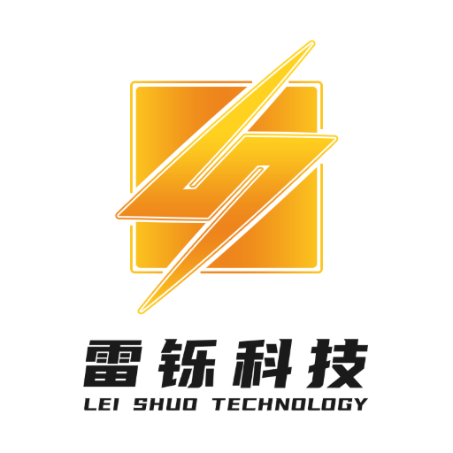
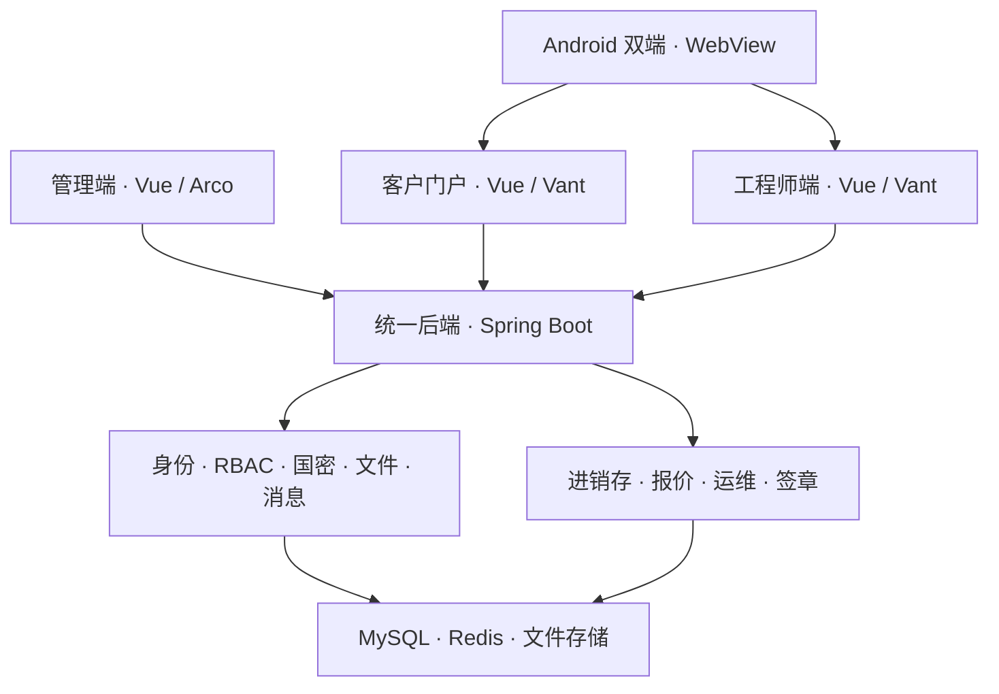

<div align="center">



# LS·Aegis OA

**把业务连接起来，让管理有序流转。**

进销存 · 运维报修 · 报价管理 · 电子签章


[架构设计](Docs/architecture/platform.md) · [业务流程](Docs/business/overview.md) · [开发构建](Docs/guides/development.md) · [部署架构](Docs/operations/deployment.md)

</div>

---

## 一个平台，贯通业务

LS·Aegis OA 是面向日常经营与运维服务的一体化管理平台。管理端、客户门户、工程师端和 Android 入口共用业务后端，在统一身份、权限和数据边界下连接采购、销售、报修、维修、结算与签署。

产品基于 LS·Aegis 技术底座。**OA 是平台名称，现有业务范围以下表为准。**

| 功能域 | 核心能力 | 业务连接 |
| :--- | :--- | :--- |
| 平台管理 | 账户、组织、角色、菜单、文件与消息 | 为各业务域提供统一公共能力 |
| 进销存 | 客商与商品、采购销售、库存、应收应付、收付款 | 承接维修材料出库和结算应收 |
| 报价管理 | 报价编制、状态流转、文档导出 | 关联运维工单 |
| 运维服务 | 客户报修、派单、接单、维修记录、完工与结算 | 连接客户、工程师和财务 |
| 电子签章 | 项目、文件、印章、签署与结果验证 | 共用平台身份和文件权限 |

## 架构概览



- **统一入口**：各端复用既有身份体系和业务接口，不单独建立业务数据库。
- **职责清晰**：页面负责交互，后端负责授权、状态转换、金额和事务。
- **联动一致**：库存由进销存单据维护；维修结算形成应收，收款形成实收。
- **持久化独立**：容器和镜像可重建，数据库、附件与密钥独立保存。

## 工程结构

```text
ls-aegis-oa/
├── ls-aegis-server/     后端与业务模块
├── ls-aegis-web/        PC 管理端
├── ls-aegis-h5/         客户 / 工程师 H5
├── android-demo/        Android WebView 双端入口
├── docker/             容器配置与网关
├── docker-compose.yml  生产服务编排
├── scripts/            构建、部署与维护工具
├── Docs/               架构与业务文档
└── agents/ skills/ rules/  工程协作规范
```

源码目录、Java 包名和数据库迁移标识延续技术底座命名，产品版本以 [VERSION](VERSION) 为准。

## 从这里开始

| 你需要了解 | 阅读入口 |
| :--- | :--- |
| 平台如何组织 | [架构与模块边界](Docs/architecture/platform.md) |
| 业务如何流转 | [模块与业务联动](Docs/business/overview.md) |
| 工程如何构建 | [开发与构建](Docs/guides/development.md) |
| 服务如何部署 | [部署与环境分层](Docs/operations/deployment.md) |
| 数据如何保存和恢复 | [数据与密钥生命周期](Docs/operations/data-and-recovery.md) |
| 接口如何保持一致 | [接口与数据一致性](Docs/architecture/contracts.md) |
| Android 如何接入 | [Android 应用架构](android-demo/README.md) |
| 当前版本的交付范围 | [1.0.0 版本说明](Docs/releases/1.0.0.md) |

## 部署原则

后端使用 **JDK 21 / Maven**，PC 使用 **pnpm 9**，H5 使用 **npm**；生产服务由 Docker Compose 统一编排。实际构建命令、环境配置和网络关系见对应指南。

全新数据库使用 `ls-aegis-server/sql/init.sql`，已有数据库按适用范围升级。Git 保存源码与配置模板；数据库、业务附件、真实环境配置和密钥不随源码分发。

## 工程约定与许可

维护入口为 [AGENTS.md](AGENTS.md)，文档总览为 [Docs](Docs/README.md)。各模块保留自己的许可文件与第三方声明，见 [后端许可](ls-aegis-server/LICENSE)和[前端许可](ls-aegis-web/LICENSE)。
