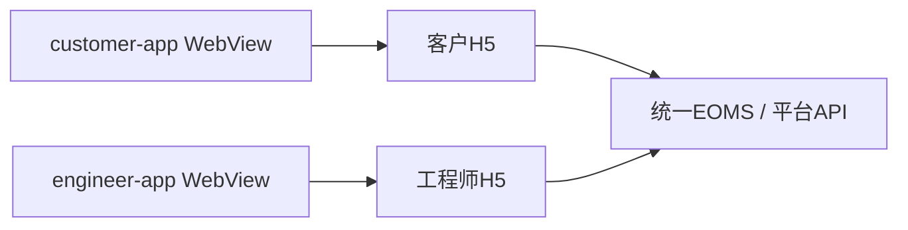

# LS·Aegis 雷铄 OA 安全应用构建平台 · Android 应用架构

## 双端模块

工程包含customer-app与engineer-app两个独立应用模块，分别承载客户门户和工程师入口。当前采用Android Activity与WebView，业务页面、状态和权限来自对应H5及平台后端。

| 模块 | 应用名称 | 页面入口 | 身份来源 |
|---|---|---|---|
| customer-app | 客户服务 | 客户H5 /customer/auth | 邀请激活后的客户会话 |
| engineer-app | 工程师 | 工程师H5 /engineer/login | 平台工程师账户 |

包名保留现有标识以维持应用身份。平台与两端App的发布版本统一由根VERSION维护；两端versionName同步为1.2.0，versionCode同步为8并随新包递增。App通过自身版本标识让“我的／关于”显示实际安装版本，普通浏览器继续显示H5平台版本。

两端欢迎卡片共用布局，服务中心标题独立居中，名称以单行自适应字号展示；极长名称保留单行横向查看能力，不用省略号替代名称。默认Logo及应用图标使用随源码部署的正式品牌文件，平台SITE配置仍可覆盖页面Logo。

## 页面与后端关系



两端继承共享的ImageUploadActivity，点击照片入口后显示应用自绘的底部圆角选择面板，含拍照、从相册选择、剩余名额和取消；系统相机与相册选择器继续沿用设备界面。拍照委托系统相机，用AndroidX FileProvider接收完整照片，授权范围仅为应用缓存的upload-capture目录；完成或取消后撤回相机URI授权，已选照片保留到当前Activity结束。相册在Android 13及以上优先使用系统Photo Picker，不可用时回退系统文档选择器，按网页提供的剩余名额限制多选。

位置水印通过网页定位接口按需申请前台定位，仅放行当前受信任页面，不持久保存站点授权；支持精确或大致位置，不申请后台定位。拒绝、不可用或超时后使用时间水印继续上传。取得坐标后，App优先异步调用Android系统Geocoder解析中文地址，无需自备地图AK；仅接受当前受信任页面并有前台位置授权的请求，不保留跨页面结果。无系统服务、空结果或超时仅回退坐标，不阻断照片上传；平台自配外部地图API已停用，不再自动调用。网页普通浏览器不调用原生地址通道。

网页和原生层分别校验选中图片；只允许受信任站点触发选择，取消后可重选，过期请求不串入新页面。相册文件读取在后台线程进行。应用禁止file路径访问，不申请全盘存储、整个相册、麦克风、后台位置或本App的CAMERA权限；系统相机应用负责自身权限。网页直接相机/麦克风流默认拒绝，使用照片来源菜单完成拍照。若系统重建Activity导致原网页回调丢失，需重新添加照片，不承诺离线草稿自动恢复。

文件类型与大小仍由网页和后端校验，服务端在生成水印前处理JPEG的EXIF旋转及镜像方向。不包含独立离线业务页面，也不在Android侧复制库存、结算或签署逻辑。

## 待办与导航

两端底部导航共用“我的待办、工作台、我的”入口，列表页可保留当前列表的上下文入口。“我的待办”位于工作台左侧，沿用各端已有身份和数据归属。

客户待办只包含本人所属租户下、处于待结算或已完成状态且尚未确认维修结果的工单所对应的报修，确认后移出待办。工程师待办按待接单、待开工、维修中分类，复用平台分配给当前工程师的任务查询；后台待结算和已结算任务在工程师工作台统一归入已完成，前端不暴露费用结算状态；工单池位于我的待办左侧，仅工程师站显示。

## 入口与网络

入口来自BuildConfig，由Gradle参数`itlsCustomerEntryUrl`、`itlsEngineerEntryUrl`分别指定完整HTTPS地址。局域网交付包直连Compose移动HTTPS网关，无需ADB连接；同一Wi-Fi须能访问服务器，服务器须在线，建议为服务器保留固定局域网地址。

仅未指定参数的开发构建保留回环入口：客户`http://127.0.0.1:25684/customer/auth`、工程师`http://127.0.0.1:25685/engineer/login`，此开发模式需要ADB转发：

```bash
adb reverse tcp:25684 tcp:25684
adb reverse tcp:25685 tcp:25685
```

局域网配置使用`python scripts/mobile-lan-setup.py --ip <服务器局域网IPv4>`生成`.local/mobile-lan/profile.json`、私有TLS目录及Android调试资源。私有CA仅被构建为信任该服务器地址的App采用，不修改手机全局信任，不忽略SSL错误。将profile中的`androidResources`通过`-PitlsLanResources=<绝对路径>`传给两端构建，并传入两个入口参数。没有这些局域网参数的包不能视作直连包。

部署时在本机Compose命令后追加`-f docker-compose.mobile.yml`，配置`LS_AEGIS_MOBILE_BIND_IP`和`LS_AEGIS_MOBILE_TLS_DIR`；网关端口8443、8444，仅发布在指定服务器网卡。防火墙只允许本地子网访问这两个端口；不要开放MySQL、Redis或原后端端口。TLS私钥、CA私钥、设备资源与本地配置均留在`.local/`，不提交Git。重建保留CA及密钥；地址变化须同步证书和App入口，证书临近到期需计划续期。

正式发布必须传入实际HTTPS入口并使用系统可信证书，不携带本机调试CA。页面可提供的设备能力受WebView与当前Activity实现约束；定位仍按需申请，地址解析失败继续原回退规则。

移动端API沿当前入口同源转发：`/auth/`用于认证，`/eoms/`用于业务，`/user/profile/`用于平台个人改密等操作。开发Vite与部署Nginx须保留相同路径和HTTP方法；接口不能回退为SPA页面，尤其个人改密的PATCH请求需到达后端统一鉴权。

## 构建链

工程使用JDK21、Android SDK35和Gradle Wrapper，分别生成两端APK：

```bash
./gradlew :customer-app:assembleDebug :engineer-app:assembleDebug
```

Windows使用gradlew.bat。SDK位置由ANDROID_HOME、ANDROID_SDK_ROOT或本机local.properties提供；SDK、缓存、签名和构建产物独立管理，不随源码提交。
