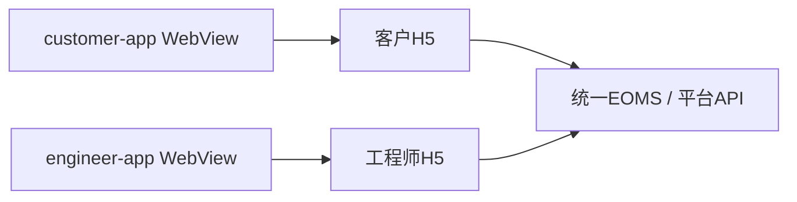

# LS·Aegis 雷铄 OA 安全应用构建平台 · Android 应用架构

## 双端模块

工程包含customer-app与engineer-app两个独立应用模块，分别承载客户门户和工程师入口。当前采用Android Activity与WebView，业务页面、状态和权限来自对应H5及平台后端。

| 模块 | 应用名称 | 页面入口 | 身份来源 |
|---|---|---|---|
| customer-app | 客户服务 | 客户H5 /customer/auth | 邀请激活后的客户会话 |
| engineer-app | 工程师 | 工程师H5 /engineer/login | 平台工程师账户 |

包名保留现有标识以维持应用身份。versionName与工程版本保持一致，versionCode用于Android安装升级。

两端欢迎卡片共用布局，服务中心标题独立居中，名称以单行自适应字号展示；极长名称保留单行横向查看能力，不用省略号替代名称。默认Logo及应用图标使用随源码部署的正式品牌文件，平台SITE配置仍可覆盖页面Logo。

## 页面与后端关系



两端使用相同的WebView设置：启用JavaScript与DOM存储，禁止文件和Content访问，使用WebViewClient承接页面导航。不包含独立离线业务页面，也不在Android侧复制库存、结算或签署逻辑。

## 待办与导航

两端底部导航共用“我的待办、工作台、我的”入口，列表页可保留当前列表的上下文入口。“我的待办”位于工作台左侧，沿用各端已有身份和数据归属。

客户待办只包含本人所属租户下、处于待结算或已完成状态且尚未确认维修结果的工单所对应的报修，确认后移出待办。工程师待办按待接单、待开工、维修中分类，复用平台分配给当前工程师的任务查询；待结算和已完成任务仍从工作台查看。

## 入口与网络

当前入口常量位于各模块MainActivity：客户为 `http://127.0.0.1:25684/customer/auth`，工程师为 `http://127.0.0.1:25685/engineer/login`。设备上的回环地址指向设备本身；采用该配置时，需要ADB反向端口连接宿主H5服务。

```bash
adb reverse tcp:25684 tcp:25684
adb reverse tcp:25685 tcp:25685
```

面向独立设备部署时，应明确设置实际服务入口及HTTPS策略，不能把宿主回环地址当作公网地址。页面可提供的设备能力受WebView与当前Activity实现约束。

## 构建链

工程使用JDK21、Android SDK35和Gradle Wrapper，分别生成两端APK：

```bash
./gradlew :customer-app:assembleDebug :engineer-app:assembleDebug
```

Windows使用gradlew.bat。SDK位置由ANDROID_HOME、ANDROID_SDK_ROOT或本机local.properties提供；SDK、缓存、签名和构建产物独立管理，不随源码提交。
